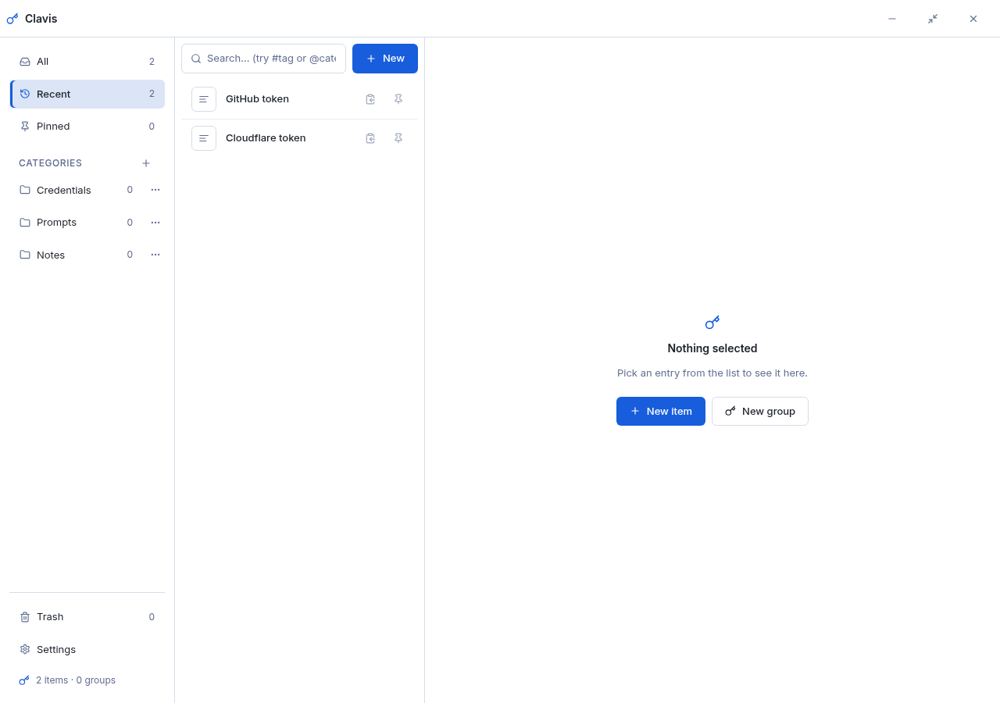

# Clavis

**Your keys, one shortcut away.** A tiny, ultra-fast Windows 10/11 tray app for
people who copy the same credentials, prompts and notes all day long.

Press **Ctrl + Shift + Space** anywhere in Windows, type a few letters
(`ghtk` finds *GitHub token*), press **Enter** — and it's on your clipboard.
Copied secrets are automatically kept out of the Windows clipboard history
(Win+V) and out of cloud clipboard sync.



## Highlights

- **Keyboard-first quick search** — fuzzy matching, `#tag` and `@category`
  filters, groups open with `→`, whole-group copy as `KEY=value` lines with
  dotenv quoting.
- **Manager window** — items, groups (shared by reference: edit once, every
  group sees it), categories, tags, trash with 30-day retention and Undo
  on every delete. Every row has an instant-copy button and a pin toggle;
  new groups can be built by pasting a whole project's `.env`.
- **Safe by design** — atomic writes, automatic daily backups (plus backups
  before every import/migration), corrupt-file auto-recovery, a read-only
  guard for files from newer versions.
- **Import / export** — full JSON backups (replace or merge), per-item/group
  Markdown and TXT, whole-folder import, "export all as Markdown".
- **Dark glass design** — self-drawn glassmorphism that works on Windows 10
  (no Windows 11 effects needed), token-driven styling, AA contrast.
- **In-app self-update** — Settings → About checks GitHub for a newer release; one click downloads and installs it (installed and portable editions), relaunches Clavis, and never touches your data. Pull-only network use: two GETs to github.com when you check (or once per 12 h in the background). No telemetry, no analytics, no accounts.

Data lives in `%APPDATA%\Clavis` (shared by the installed and portable
builds), with automatic backups in `%APPDATA%\Clavis\backups`.

## Install

Download from [Releases](../../releases):

| File | What it is |
| --- | --- |
| `Clavis-Setup-1.0.3.exe` | The installer (per-user, no admin needed) |
| `Clavis-Portable-1.0.3.exe` | The portable single file (no install) |

## Build from source

Requires Go 1.26+ and Node/bun.

```
cd frontend && bun install && bun run build
cd .. && go test ./internal/...
GOOS=windows GOARCH=amd64 CGO_ENABLED=0 go build -ldflags "-s -w -H windowsgui" -o dist/Clavis.exe .
```

The Go core (store, exchange, search) is pure and fully unit-tested on any
platform; `go run ./tools/syso …` embeds the icon/version/manifest, and
`build/windows/installer/clavis.nsi` builds the installer with NSIS.

## Structure

```
main.go, app.go        windows, tray, hotkey, dispatcher service
internal/store         data model, atomic writes, backups, trash, undo
internal/exchange      dotenv, Markdown/TXT import+export
internal/search        the documented search/ranking algorithm
internal/clipboard     Windows clipboard with privacy formats
internal/system        registry transparency, cursor, explorer
frontend/              React + TypeScript + Vite (popup + manager entries)
build/                 icons, manifest, version info, NSIS script
SPEC.md, design-tokens.css   the product spec and the single source of style
```

Wails **v3.0.0-beta.33** (pinned in `go.mod`), React 19, TypeScript 5.
